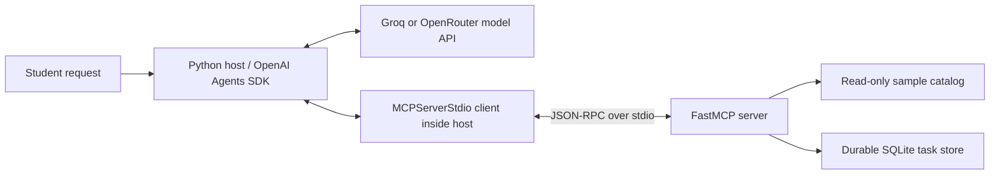

# Campus Study Planner

**EECE 503P/798S - C5 Agent Tools assignment**

A focused MCP toolkit that helps a student find a learning resource and save a study intention. The server exposes **exactly three tools**. The agent uses the **OpenAI Agents SDK**, with Groq's free-tier API as the default model provider and OpenRouter as an optional provider. An OpenAI API key is not required.

All catalog records and campus locations are explicitly fictional sample data. The saved tasks are real local SQLite records. A task is an intention to study; it does not create a calendar event, send a notification, or reserve university facilities.

## Tool contracts

| Category | MCP tool | Inputs | Output | Side effect / predictable failure |
|---|---|---|---|---|
| Data | `find_study_resource` | `topic: str` | `StudyResource` | Reads the catalog only. Unknown topics return an explicit error with available topics. |
| Action | `create_study_task` | `resource_title: str`, `minutes: int`, `request_id: str` | `StudyTask` | Saves one task. Rejects invalid duration and conflicting retry keys. |
| Orchestration | `plan_study_session` | `topic: str`, `minutes: int`, `request_id: str` | `StudyPlan` | Runs the same lookup operation followed by the same creation operation. Failed lookup creates no task. |

Each function has a descriptive docstring, documented parameter constraints, and a Pydantic output model. FastMCP exposes these as typed input and output schemas. The duration is a strict integer from **5 to 180**. Topic and request ID are nonempty, at most 100 characters; resource title is nonempty, at most 160 characters. Whitespace is normalized before validation and retry comparison. Booleans and decimal durations are rejected.

`request_id` identifies one intended task. Retrying the same key with the same title and duration returns the original task, including its ID and timestamp. The same key with different data fails. A new intention requires a new key. SQLite transactions and a unique constraint protect the check and insert against concurrent retries.

Supported catalog topics are `Python async`, `REST APIs`, and `MCP tools`. Examples of aliases are `python`, `asyncio`, `rest`, `http`, and `mcp`. Matching ignores case and repeated whitespace and is deliberately exact rather than an undocumented fuzzy search.

## Architecture



The **Host** is `client.py`: it runs the agent and owns the connection. Its **MCP Client**, `MCPServerStdio`, starts and connects to a separate **MCP Server**, `server.py`. The client discovers the actual tool schemas. The model chooses a tool and arguments; the SDK routes that call through MCP. The server executes it, the result travels back to the model, and the model produces the final reply. The application does not classify prompts with hard-coded keywords.

Orchestration happens inside the server's service layer. `plan_study_session` calls the same `find_study_resource` and `create_study_task` operations used by the standalone tools. These are internal Python calls, so the orchestration scenario creates one external MCP call. Its server logs show the two real internal steps.

## Setup

Use Python **3.11 or newer** (tested with Python 3.12). From this project directory:

```powershell
python -m venv .venv
.\.venv\Scripts\python.exe -m pip install -e ".[test]"
```

Use the editable install above: the project intentionally keeps the sample catalog in the repository's `data/` directory. On macOS/Linux, replace `.\.venv\Scripts\python.exe` with `.venv/bin/python`.

Direct dependencies are pinned to the versions tested for this submission. `requirements-lock.txt` records the complete tested Windows/Python 3.12 environment; for another operating system, use `pyproject.toml` so platform-specific dependencies resolve correctly.

### Free provider: Groq

Create a key in [Groq's console](https://console.groq.com/keys) using a Free-plan account. Then run the local, non-echoing setup prompt:

```powershell
.\.venv\Scripts\python.exe scripts/setup_key.py --provider groq
```

Alternatively, copy `.env.example` to `.env` and fill `GROQ_API_KEY` locally. The default model is `openai/gpt-oss-20b`, using `https://api.groq.com/openai/v1`. Free-plan quotas apply; check [current limits](https://console.groq.com/docs/rate-limits). The code does not upgrade accounts, purchase credits, or automatically switch models.

### Optional provider: OpenRouter

```powershell
.\.venv\Scripts\python.exe scripts/setup_key.py --provider openrouter
.\.venv\Scripts\python.exe -m study_planner.client --provider openrouter
```

The default OpenRouter model is the requested `deepseek/deepseek-v4.1-flash`. Set `OPENROUTER_MODEL` or pass `--model` to choose another model with tool-calling support. OpenRouter account credit and model access depend on the selected model. A free route still needs a valid OpenRouter key.

The `.env` file is excluded from Git. Provider credentials stay in the host; the MCP subprocess receives only its storage/encoding settings. SDK tracing is disabled for this local assignment demonstration. Never include a key file or secret in the submitted repository or recording.

## Run the real agent

```powershell
.\.venv\Scripts\python.exe -m study_planner.client
```

Example requests:

```text
Find a study resource about Python async. Do not save a task.
Save a 25-minute study task for 'My REST revision notes'. Use request_id 'my-action-001'.
Find a resource about MCP tools and save a 40-minute study session. Use request_id 'my-plan-001'.
Try looking up a resource about underwater basket weaving.
```

The console prints actual tool names, JSON arguments, MCP results, and the agent's final answer. Server diagnostics go to stderr, keeping stdout available for the JSON-RPC protocol.

Type `exit` to close the host. The task database survives process restarts. View it without modifying it:

```powershell
.\.venv\Scripts\python.exe scripts/show_tasks.py
```

`STUDY_PLANNER_DB` selects another database file. The host starts the server in the project root, so relative storage paths resolve there. `--database` selects a separate absolute-resolved database for a run. The read-only viewer also accepts `--database`.

## Verify without an API key

```powershell
.\.venv\Scripts\python.exe -m pytest -q
.\.venv\Scripts\python.exe scripts/verify_mcp.py --report evidence/mcp-verification.json
```

The tests cover success and predictable failure for all three capabilities, boundary validation, literal storage of instruction-like text, read-only lookup, durable persistence, identical/conflicting retries, and prevention of partial tasks. The transport verification starts an actual FastMCP subprocess, discovers exactly three described and typed tools, makes eleven real calls, then restarts the server to check persistence.

**Verified results:** 43 tests passed. The transport check passed seven checks and eleven real MCP calls. A further SDK bridge test sends four scripted model calls through the real MCP subprocess and returns their actual results to the scripted model. This tests SDK wiring without claiming learned tool selection. See `evidence/verification_results.md` and `evidence/mcp-verification.json` for recorded scope and versions. These local tests do not establish that a hosted model successfully chose tools; that requires the following live run.

## Live demonstration

```powershell
.\.venv\Scripts\python.exe -m study_planner.client --demo --pause --delay 45 --database data/recording.sqlite3 --report evidence/live-agent.json
.\.venv\Scripts\python.exe scripts/show_tasks.py --database data/recording.sqlite3
```

The five natural-language scenarios demonstrate Data, Action, Orchestration, an unavailable topic, and an identical retry. The model chooses its tools; the host records the observed calls. The report verifies expected success/error flags and that retry returns the original task. It returns exit code 3 if a demonstrated behavior fails. A valid key, Internet access, quota, and compatible provider model are required.

For free-plan limits, narrate and inspect results between scenarios rather than sending the entire demonstration in a burst. `docs/screencast_guide.md` supplies a six-minute run order, narration, prompts, and checks.

## Deliverables and status

- `docs/written_summary.md`: 300-400 word reading summary and source-level Fetch server critique.
- `docs/reflection.md`: two-paragraph reflection.
- `src/study_planner/`: typed models, domain logic, exactly three FastMCP tools, and OpenAI Agents SDK host.
- `tests/`, `scripts/`, `.env.example`, `pyproject.toml`: verification, safe configuration, and reproducible setup.
- `docs/requirements_checklist.md`: requirement-by-requirement review.
- `docs/screencast_guide.md`: complete recording preparation.

The project is verified: 43 automated tests and all five real Groq-backed scenarios passed. The final screencast is 5 minutes 31 seconds, edited from three genuine live browser captures, with authorized synthesized voice narration. [Public repository](https://github.com/by-aseel/campus-study-planner-c5). [Watch or download the screencast](https://github.com/by-aseel/campus-study-planner-c5/raw/refs/heads/main/media/campus-study-planner-demonstration.mp4). See `docs/submission_notes.md` for the recording details.

## Implementation references

- [OpenAI Agents SDK: local MCP integration](https://developers.openai.com/api/docs/guides/agents/integrations-observability)
- [FastMCP typed tools and errors](https://gofastmcp.com/servers/tools)
- [FastMCP stdio execution](https://gofastmcp.com/deployment/running-server)
- [Groq OpenAI-compatible API](https://console.groq.com/docs/openai)
- [Groq GPT-OSS 20B and tool support](https://console.groq.com/docs/model/openai/gpt-oss-20b)
- [OpenRouter DeepSeek V4.1 Flash](https://openrouter.ai/deepseek/deepseek-v4.1-flash)

The assignment and Fall 2026 C5 lecture deck are the course sources. Additional reading references are listed with the written summary.

## Recording dashboard

For a readable live demonstration view, run:

```powershell
.\.venv\Scripts\python.exe scripts/recording_dashboard.py --database data/dashboard.sqlite3
```

Open the printed local URL and start the demonstration. It calls the same real SDK host and MCP server, with timed gaps for narration and free-tier quota. `evidence/recorded-live-agent.json` records the observed run. `docs/narration_script.md` contains the timed narration for the edited recording.
